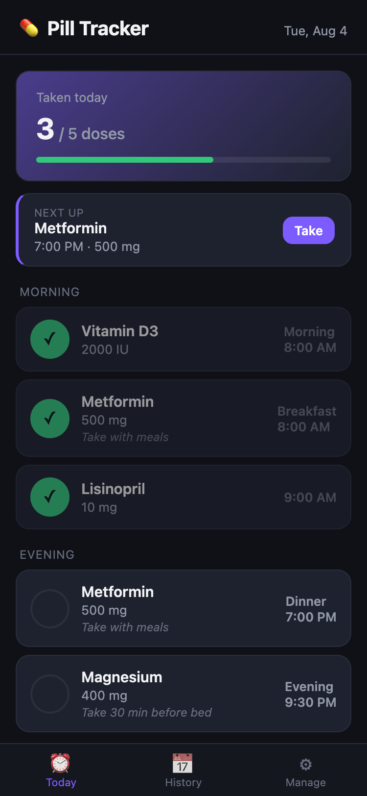
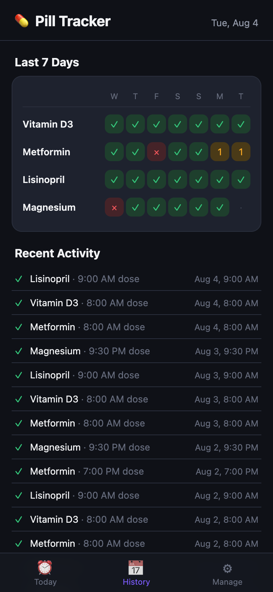
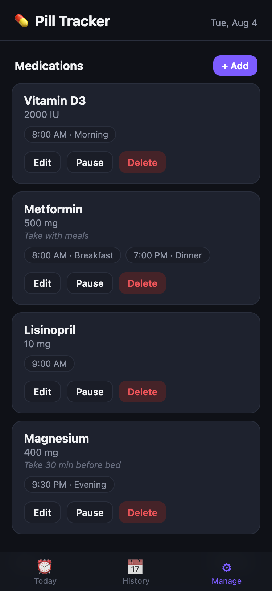

# Pill Tracker

A small Flask web app for keeping track of daily medications. Answers three
questions at a glance: what's due next, have I taken everything today, and how
has the last week gone.

Designed mobile-first, dark by default, and intentionally kept simple — no
database, no build step, no frameworks. Add it to the iPhone home screen and it
opens fullscreen like a native app.

| Today | History | Manage |
|:---:|:---:|:---:|
|  |  |  |

<sub>Screenshots use sample data.</sub>

## Features

- **Today** — every dose for the day grouped into Morning / Afternoon / Evening,
  with a progress ring and a "next up" card that turns red when a dose is
  overdue. One tap to check a dose off.
- **History** — a 7-day grid per medication (✓ full, number = partial, × missed).
  Tap any day to open it and backfill a dose you forgot to log.
- **Manage** — add, edit, pause, or delete medications. Pausing keeps the
  history but drops the medication off the daily list, for things you cycle on
  and off.
- Each medication has an optional dosage and instructions, plus any number of
  scheduled times per day with optional labels ("Breakfast", "Evening").

All date and time reasoning happens in the browser, so the app follows the
phone's clock rather than the container's.

## Run with Docker Compose

```bash
docker compose up -d
```

Pulls the prebuilt image from `ghcr.io/looselycoupled/pill-tracker-webapp`
(amd64 and arm64, rebuilt on every push to `main`). To build from source
instead, swap the compose file's `image:` line for `build: .` and run
`docker compose up --build`.

Then open <http://localhost:8070>.

Data persists to `./data/pills.json`.

## Run locally (no Docker)

```bash
pip install -r requirements.txt
python app.py
```

Runs at <http://localhost:8000> in debug mode.

## API

| Method | Endpoint | Description |
|--------|----------|-------------|
| GET | `/api/data` | All medications and the dose log |
| POST | `/api/medications` | Add a medication |
| PUT | `/api/medications/<id>` | Edit a medication (any subset of fields) |
| DELETE | `/api/medications/<id>` | Remove a medication and its log entries |
| POST | `/api/log/toggle` | Flip taken/not-taken for one dose on one date |
| POST | `/api/backup` | Snapshot `pills.json` into `data/backups/` |
| GET | `/api/backups` | List existing backups, newest first |
| GET | `/healthz` | Health check |

`POST /api/log/toggle` takes `{ "medication_id", "date": "YYYY-MM-DD", "time": "HH:MM" }`.
The log is pruned to the last 120 days on write.

## Backups

The **Backup** button under Manage → Data copies `pills.json` to
`data/backups/pills-YYYYMMDD-HHMMSS.json`, timestamped with the container's
local clock. Backups accumulate — nothing is auto-deleted, so prune the
directory yourself if it ever gets long. Restoring is a file copy:

```bash
cp data/backups/pills-20260804-134604.json data/pills.json
```

The container reads the file on every request, so a restore takes effect on the
next page load — no restart needed.
